# OpenDisco: Open Discovery Tool for Ubiquiti Devices

One tool for finding and diagnosing Ubiquiti devices (UniFi, airMAX, EdgeMAX, UISP, AmpliFi)
and identifying other WISP gear. It combines the discovery methods of three Ubiquiti tools,
merges what they find by MAC address, and checks each device for common problems.

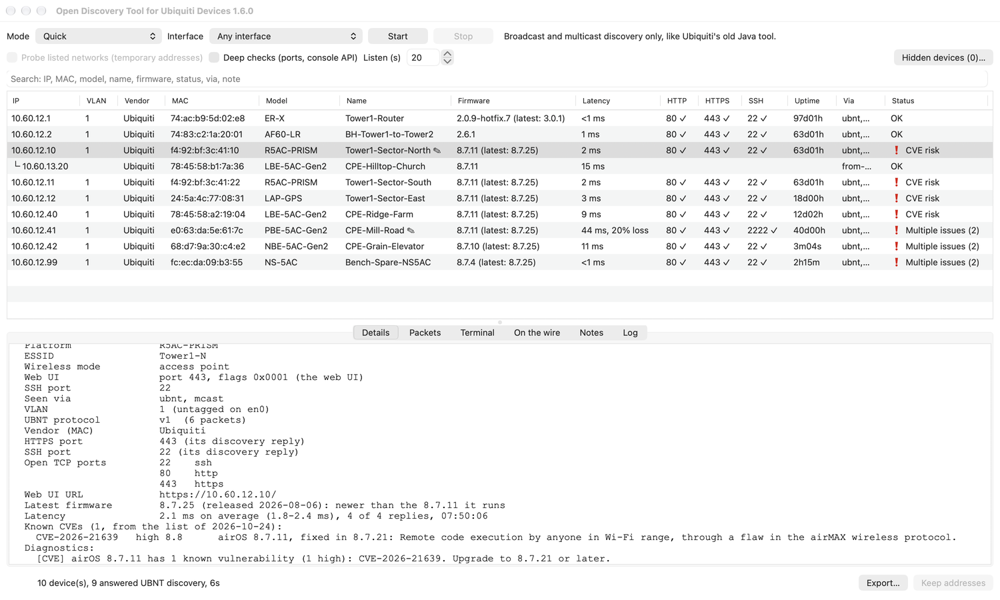

*OpenDisco 1.6.0 on macOS. The devices are sample data, a small WISP's tower with made-up
names and addresses. More pictures under [Screenshots](#screenshots).*

OpenDisco is an independent project. It isn't made, endorsed or supported by Ubiquiti Inc.
Ubiquiti, UniFi, UniFi OS, airMAX, airFiber, LTU, GigaBeam, EdgeMAX, EdgeOS, EdgeRouter,
EdgeSwitch, UISP, AmpliFi and WiFiman are trademarks of Ubiquiti Inc., and other product names
belong to their owners; they appear here only to say what the tool works with.

| Borrowed from | Method | What it finds |
|---|---|---|
| Legacy Device Discovery Tool (Java) | UBNT discovery v1 probe, broadcast to UDP 10001 | airMAX, EdgeMAX, older UniFi |
| WiFiman | v1 + v2 probes, **unicast sweep** of a subnet, ARP table vendor (OUI) match | devices behind routers/VPNs; Ubiquiti gear with discovery turned off |
| UniFi Network app / controller | multicast probe to 233.89.188.1, **passive listening** for adoption announcements, mDNS + SSDP, UniFi OS console API | unadopted devices, consoles, other controllers on the LAN |

It comes two ways:
- **A native app** for macOS, Windows, Linux and Android phones and tablets (see
  [The app](#the-app)). The iPhone and iPad version is in beta from 1.5.0: it's being tested,
  with no public download yet.
- **The command-line tool,** which needs only Python 3.8 or newer with no packages to
  install, and runs on macOS, Linux and Windows.

## Screenshots

Every picture shows OpenDisco 1.6.0 (Export and the Site Report: 1.7.0) with the same sample
data: made-up names and addresses.

<table>
<tr>
<td width="50%">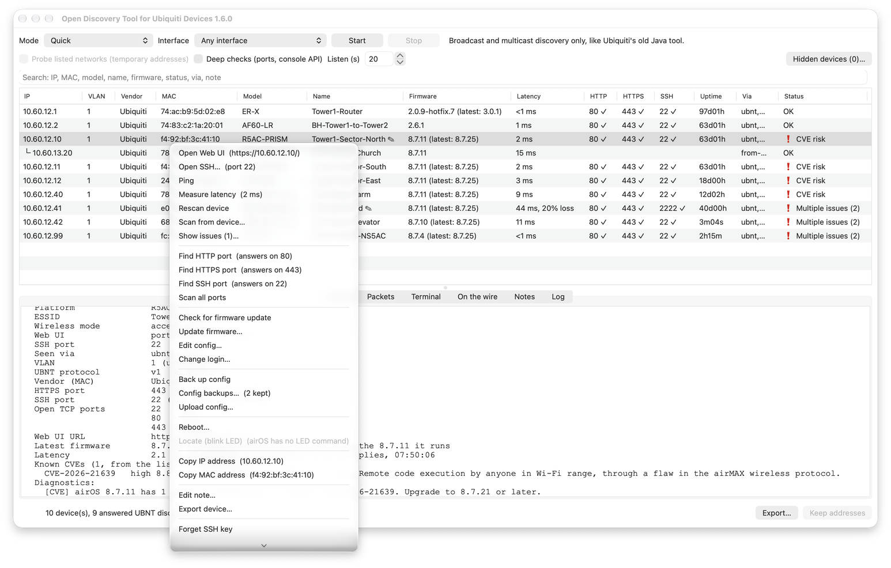</td>
<td width="50%">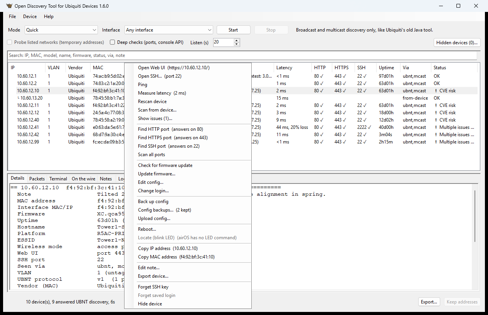</td>
</tr>
<tr>
<td>A device's right-click menu (macOS): its web UI, SSH, ping and latency, port finder,
firmware, config backups and uploads, reboot, a note and its own export.</td>
<td>The same menu on Windows 11.</td>
</tr>
<tr>
<td>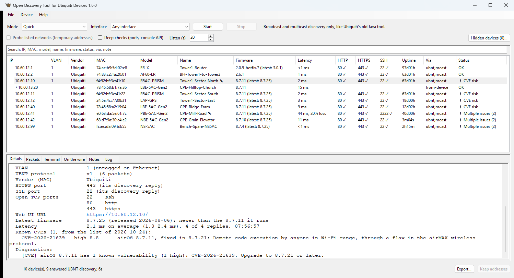</td>
<td>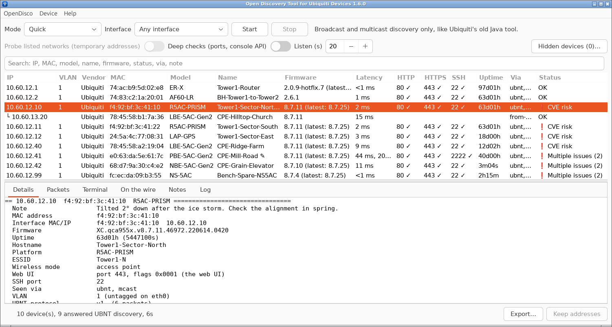</td>
</tr>
<tr>
<td>Windows 11.</td>
<td>Ubuntu 24.04.</td>
</tr>
<tr>
<td>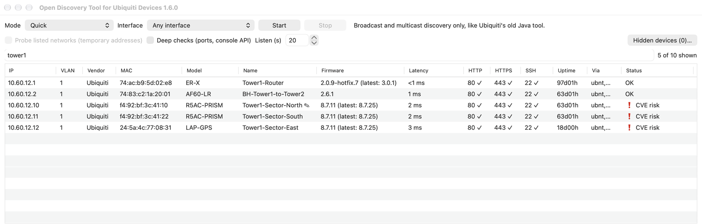</td>
<td>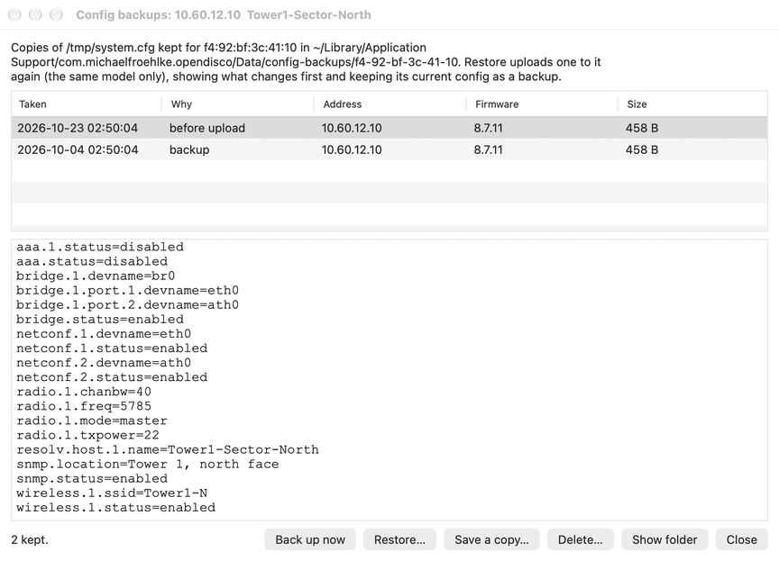</td>
</tr>
<tr>
<td>Search: "tower1" keeps 5 of the 10 devices.</td>
<td>Config backups of one radio, kept by its MAC address, with Restore, Save a copy and Delete.</td>
</tr>
<tr>
<td>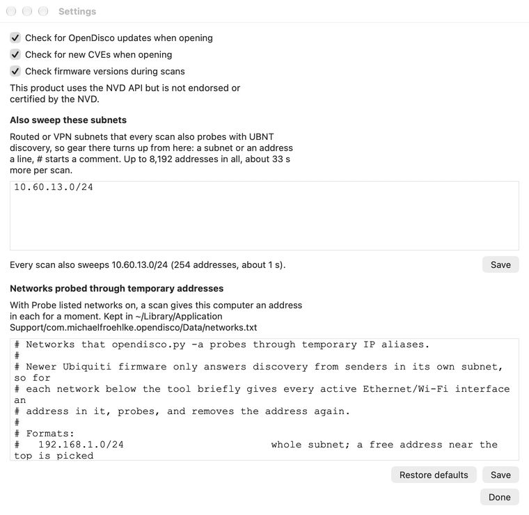</td>
<td>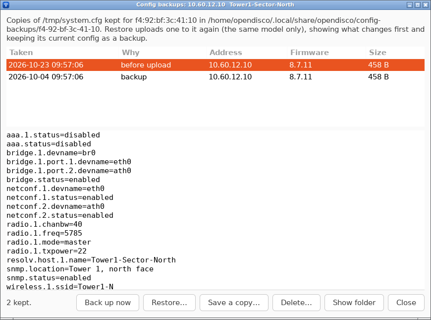</td>
</tr>
<tr>
<td>Settings: the update, CVE and firmware checks, the subnets every scan also sweeps, and the
networks probed through temporary addresses.</td>
<td>Config backups on Ubuntu 24.04.</td>
</tr>
<tr>
<td>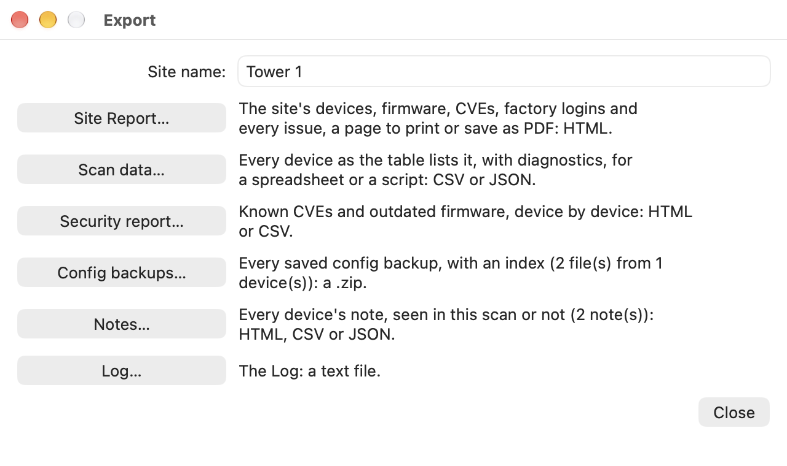</td>
<td>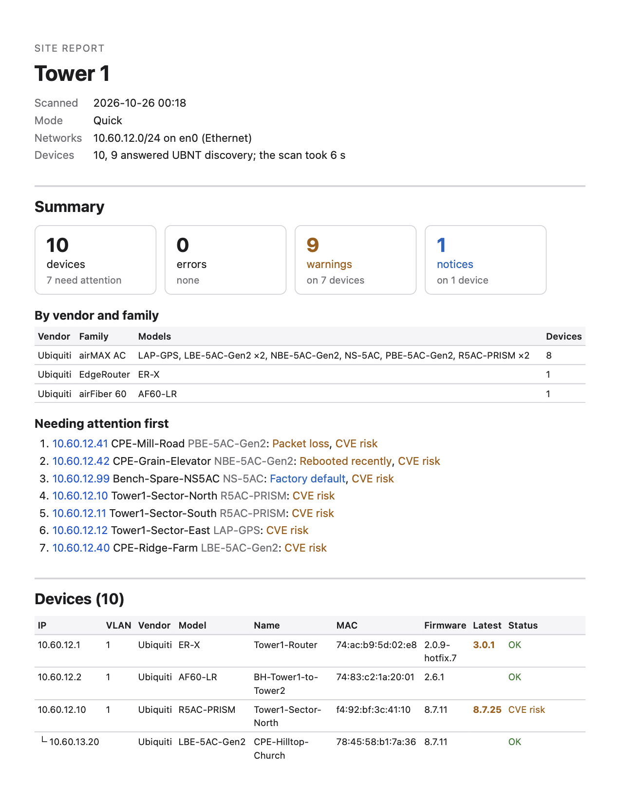</td>
</tr>
<tr>
<td>Export: the site's name, then the Site Report, the scan's data and the site-wide extras.</td>
<td>The Site Report, printed: the site, a summary, the devices needing attention first and the
device table; CVEs, factory logins, firmware updates, latency, other issues and notes follow.</td>
</tr>
</table>

Phones and tablets ([On phones and tablets](#on-phones-and-tablets)):

<table>
<tr>
<td>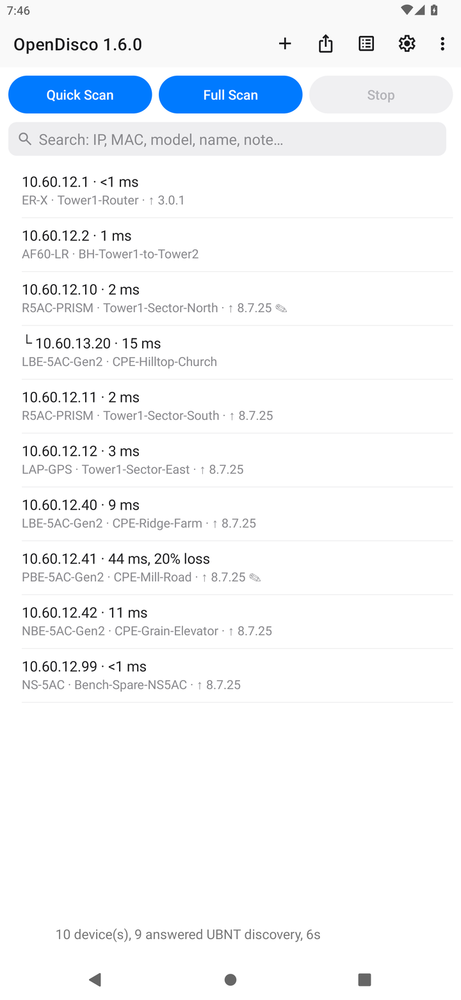</td>
<td>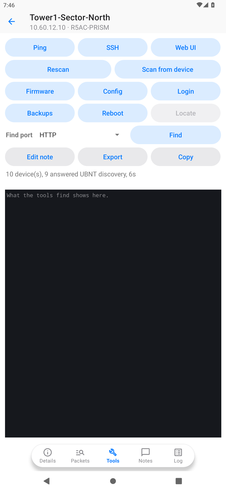</td>
<td>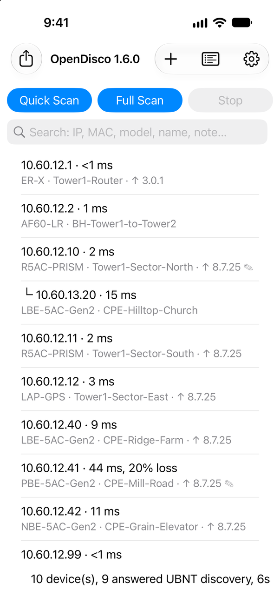</td>
<td>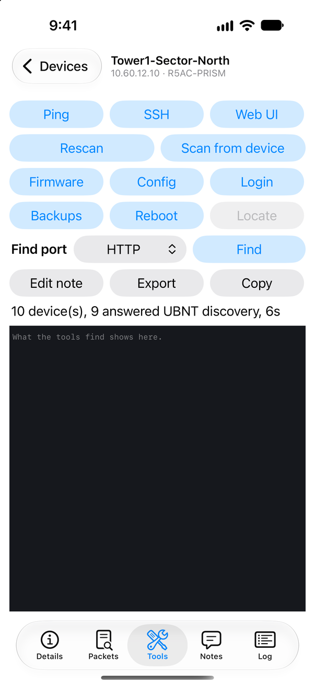</td>
</tr>
<tr>
<td>Android: the list, with each device's latency and newer firmware (↑).</td>
<td>Android: a radio's Tools.</td>
<td>iPhone (beta): the list.</td>
<td>iPhone (beta): a radio's Tools.</td>
</tr>
</table>

<table>
<tr>
<td width="50%">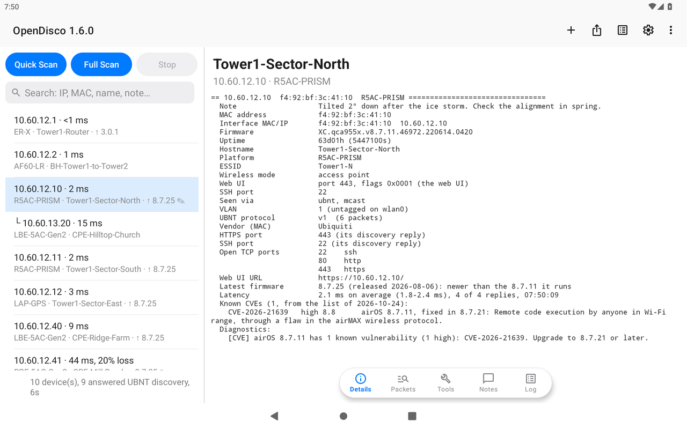</td>
<td width="50%">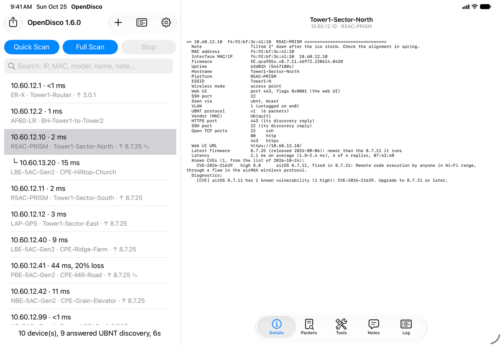</td>
</tr>
<tr>
<td>Android tablet: the list beside the radio's page.</td>
<td>iPad (beta), the same.</td>
</tr>
</table>

## Versions and platforms

Installers are on the [Releases](https://github.com/Nekobyte-Coding/opendisco/releases) page.

| Version | What's new | Released for | Known issues (fixed in) |
|---|---|---|---|
| 1.6.2 | The Linux packages name the project's homepage | macOS, Windows, Linux, Android; iOS (beta, no public download yet) |  |
| 1.6.1 | Terms of use, shown when the app first opens and after each upgrade, to be accepted before use (the command line asks too). Each device tool's confirmation says what can go wrong. Windows and Linux: the window starts wider when the screen has room, and the list's columns fit what they hold. Open-source licenses… lists the licenses of what each build bundles | macOS, Windows, Linux, Android; iOS (beta, no public download yet) | Linux: the .deb and .rpm give the homepage as "None" (1.6.2) |
| 1.6.0 | Config backups, Upload config… with what changes shown first, and Apply (airMAX, airFiber, LTU, GigaBeam, EdgeOS). Reboot, and Locate for UniFi access points and switches. Scan from a device given by its address, over a VPN too. Each device's latest firmware during scans, and a Latency column. Search, a note per device, Export device…, and a security report, all config backups, all notes and the Log. Settings holds the networks list and "Also sweep these subnets", on every platform. Tablets and iPads show the device list and a device's page side by side. The adapter picker is called Interface | macOS, Windows, Linux, Android; iOS (beta, no public download yet) | Windows and Linux: at the window's first size, long names, firmware and statuses are cut short. Details says "1 packets" (1.6.1) |
| 1.5.0 | Find HTTP/HTTPS/SSH port and Scan all ports for one device, and an HTTP column. Status in plain words with an issue list. A CVE check of each device's firmware, updated from the NVD. TFTP recovery detection. Device tools over SSH: firmware updates, config editor, change login, Scan from device, devices behind other devices. Settings and self-update. A new phone layout | macOS, Windows, Linux, Android; iOS (beta, no public download yet) |  |
| 1.4.2 | "Probe listed networks" no longer stays on after Direct or Trunk VLANs. Start waits for Keep addresses. Android names the export file it saved. Clearer networks-file errors | macOS, Windows, Linux, Android | macOS: a scan can find nothing on a Mac that has an older OpenDisco (another app ID) or another app built with Briefcase (1.5.0) |
| 1.4.1 | Android release-signed, with a three-column list. Windows fixes: Keep addresses, adapter names with spaces, the About version, the data folder. CSV exports open right in Excel | macOS, Windows, Linux, Android | "Probe listed networks" stays on after Direct or Trunk VLANs, so the next scan adds temporary addresses (1.4.2). Android: a second export in the same minute is reported under the first one's file name (1.4.2) |
| 1.4.0 | Renamed OpenDisco, Apache 2.0 license. Windows sniffs and hears VLANs (through Npcap) and adds temporary addresses. First Android release. The Windows app opens again | macOS, Windows, Linux, Android | Windows: Keep addresses fails, and a Port whose adapter name has a space (Ethernet 2) isn't the one scanned (1.4.1). Android: Export does nothing (1.4.1). "Probe my networks" stays on after Direct or Trunk VLANs (1.4.2) |
| 1.3.2 | First Linux release (.deb, .rpm, portable). A UCG Fiber's HTTPS port is read correctly | macOS, Windows, Linux | Windows: the app doesn't open (1.4.0). Mac and Linux: "Probe my networks" stays on after Direct or Trunk VLANs (1.4.2) |
| 1.3.1 | Popup windows open over the app. Open Web UI uses the port the device reports | macOS, Windows | Windows: the app doesn't open (1.4.0). A UCG Fiber's port 7080 is shown as its HTTPS port (1.3.2). Mac and Linux: "Probe my networks" stays on after Direct or Trunk VLANs (1.4.2) |
| 1.3.0 | Right-click menu and Terminal tab (SSH and ping sessions). HTTPS and SSH ports from what each device reports, with typo checks. Hidden devices | macOS, Windows | Same as 1.3.1, and Open Web UI uses the standard port, not the one the device reports, when a deep check found nothing answering (1.3.1) |
| 1.2.0 | Packets tab with each device's packets, decoded and checked for damage. Missed-reply and error counters. The unicast sweep finds UniFi OS gear | macOS, Windows | Windows: the table's columns open too narrow to read (1.4.0). A UCG Fiber's port 7080 is shown as its HTTPS port (1.3.2). Mac and Linux: "Probe my networks" stays on after Direct or Trunk VLANs (1.4.2) |
| 1.1.0 | First app release, for macOS and Windows: a window over the command-line scanner, with Touch ID for sudo and HTTPS and SSH port columns | macOS, Windows | Same as 1.2.0, and the unicast sweep misses UniFi OS gear (1.2.0) |

- **Rebuilds:** every installer before 1.4.0 was rebuilt in October 2026 from that version's
  own source, under the current name, license and app ID, with the default networks list cut
  down to 192.168.1.0/24. No fixes were back-ported: each version behaves as it did when it
  came out, known issues included.
- **macOS before 1.5.0:** every version's app started from the same prebuilt launcher, and
  macOS's Local Network privacy can mistake one app built that way for another. On a Mac that
  has an older OpenDisco under another app ID (or another app built with Briefcase), it
  applied that app's setting, showed no prompt and blocked the scan, which found nothing.
  1.5.0's launcher has its own ID.
- **Linux before 1.3.2:** 1.1.0 to 1.3.1 were never released for Linux. Their Linux packages
  were built later, from each version's source with 1.3.2's Linux packaging, for
  completeness. They run, but those versions weren't made or tested for Linux at the time,
  and the 1.3.0 and 1.3.1 Linux packages have no right-click menu.
- **Linux before 1.4.0:** the Listen box's − and + buttons are drawn partly outside it
  (cosmetic, fixed in 1.4.0).
- **The 1.3.0 to 1.3.2 Windows app** stops at startup: it reads a bundled file with Windows'
  default text encoding. The command-line tool (`opendisco.cmd` in the install folder) works.
  1.4.0 fixes it.

[CHANGELOG.md](CHANGELOG.md) lists what changed in each version.

## The app

- **Mac:** open `OpenDisco-1.6.2-macos-universal.dmg` (Apple silicon and Intel Macs) and drag
  the app to Applications.
- **Windows:** run `OpenDisco-1.6.2-windows-x64-setup.exe` (64-bit; Windows on ARM runs it
  too). It installs for the current user without administrator rights, with Start menu and
  desktop shortcuts and an uninstaller in Apps.
  - **SmartScreen:** the installer isn't code-signed, so the first time Windows shows
    "Windows protected your PC": click **More info**, then **Run anyway**.
  - **Firewall:** the first scan may bring up a Windows Firewall prompt about **Python** (the
    app runs on its own bundled copy). Allow it on private networks, or devices' replies
    can't get back to the app.
  - **Command line:** the CLI on Windows is `opendisco.cmd` in the install folder
    (`%LOCALAPPDATA%\Programs\OpenDisco`), for example `opendisco.cmd --quick`.
- **Linux:**
  - **Ubuntu 24.04 LTS, Linux Mint 22, Pop!_OS 24.04:**
    `sudo apt install ./OpenDisco-1.6.2-ubuntu-24.04-amd64.deb`
  - **Fedora 44:** `sudo dnf install ./OpenDisco-1.6.2-fedora-44-x86_64.rpm`
  - **Any other distribution** (Debian 13, Arch, newer Ubuntu or Fedora...):
    - **The AppImage** (x86-64, from 1.6.2): `OpenDisco-1.6.2-linux-x86_64.AppImage`. Make it
      executable (`chmod +x`) and run it. It brings its own Python and Toga and uses the
      system's GTK 3 and WebKitGTK 4.1, which most desktops have; if they're missing, it says
      what to install. Given options, it's the command-line tool. It runs on Ubuntu 24.04,
      Debian 13, Fedora 40, Linux Mint 22 and later.
    - **The portable** `OpenDisco-1.6.2-linux.tar.gz`: extract it and run `./opendisco`; its
      `README-LINUX.md` lists the packages to install first.

  The `.deb` and `.rpm` install the app's own copy of Toga and PyGObject, built for that
  release, and pull in GTK, WebKitGTK, tcpdump, ip, iw and the ssh client. The app is in the
  desktop's app menu, and `opendisco` in a terminal runs it (with options, it's the
  command-line tool).
- **Android:** `OpenDisco-1.6.2-android.apk`: sideload it with "Install unknown apps"
  allowed, on a phone or a tablet. It installs over 1.4.1 and later, keeping its data. See
  [On phones and tablets](#on-phones-and-tablets). From 1.4.1 the app is signed with
  OpenDisco's own release key, so later versions install over it. 1.4.0 was
  signed with Android's debug key, which Android won't replace: uninstall 1.4.0 first. Nothing
  is lost: the phone app can't hide devices or edit the networks file, so it saves nothing.

**Upgrading:** saved data (Settings and the networks file, hidden devices, device notes,
config backups, remembered logins and SSH host keys) is retained with the new install and
picked up the first time the new version opens. The Windows installer removes the earlier
install; from 1.4.1 the Windows app keeps its data in
`%LOCALAPPDATA%\Nekobyte-Coding\OpenDisco` (earlier, `%LOCALAPPDATA%\Unknown\OpenDisco`).
Versions before 1.4.0 used a different app ID, so on a Mac such an app stays in
Applications until deleted, on Linux its package stays until removed, and on Android the
new version installs as a separate app.

**First opening:** the first time each version opens, the app shows its [terms of
use](TERMS.md) in place of everything else: **I agree** opens the app, **Quit** leaves (iOS
has I agree only). **Terms of Use…** shows them again: in the OpenDisco menu on a Mac, under
Help on Windows and Linux, and in Settings on phones and tablets.

**The window:**
- Pick a mode and an **Interface** (the network adapter to scan from, or "Any interface"),
  then press Start. 1.5.0 and earlier label this picker **Port**, with "Any port".
- Devices fill the table as they're found. Selecting one shows everything it reported and
  what to check. A device found through another device (Scan from device) is listed under it,
  indented.
- **Search** above the table narrows it to the devices whose IP, MAC (in any spelling), model,
  name, vendor, firmware, Status, Via or note match every word typed, ignoring case, and says
  how many it shows ("3 of 25 shown"). A device found through another keeps the devices above
  it in view.
- **Firmware** shows the version each device runs and, when Ubiquiti's firmware server lists a
  newer release for its platform, that one too: "8.7.11 (latest: 8.7.25)". **Latency** is
  measured after every scan: a few pings to each device ("3 ms", "12 ms, 25% loss", "no
  reply"). See [Firmware versions and latency](#firmware-versions-and-latency).
- **Status** names what's wrong in a word or two ("CVE risk", "Factory default", "TFTP
  recovery mode"), or "Multiple issues (3)". Hovering over a device lists its issues;
  double-clicking it (or **Show issues…**) opens the list, with each CVE's NVD page a click
  away. A device with known CVEs starts with a red ❗.
- **Right-click a device** (or use the **Device** menu) to open its web UI, SSH to it, ping
  it or measure its latency, rescan it, back up, edit or upload its config, reboot it, blink
  its LED, copy its IP or MAC, keep a note on it, export it, forget its saved SSH key, or hide
  it. See [Right-click menu and the Terminal tab](#right-click-menu-and-the-terminal-tab).
- **A note per device:** **Note…** keeps a note on a device under its MAC address, so it's
  there in every later scan: first in Details, as a ✎ after its name, in the search and in the
  exports.
- **Packets** shows the packets the selected device sent, decoded field by field with their
  hex dumps, and checked for damage (see [Damaged packets and loss](#damaged-packets-and-loss)).
- **Terminal** holds the SSH and ping sessions. Selecting a device shows its session.
- The other tabs show what was heard on the wire, the scan's notes and the log. Settings
  holds the networks probed through temporary addresses and the subnets every scan also
  sweeps (see [Settings and updates](#settings-and-updates)); before 1.6.0 the networks file
  had a tab of its own.
- **Hidden devices…** lists hidden devices and brings them back.
- **Export…** saves the **Site Report**: the scan as one page that opens on any phone or computer
  and prints cleanly, or saves as a PDF from the browser's Print. The site's name, typed above
  the buttons, heads it and is kept for the next one. It holds:
  - when the site was scanned, the scan mode and the networks scanned;
  - a summary: issues by level, the devices by vendor and family, and the devices needing
    attention first;
  - every device: IP, VLAN, vendor, model, name, MAC, firmware and the latest firmware, Status;
  - known CVEs, each linked to its NVD page; factory logins and factory-default devices;
    firmware updates; latency; every other issue, device by device; and the devices' notes.

  **Scan data…** saves the device table, with each device's diagnostics, as CSV (for a
  spreadsheet) or JSON. The site-wide extras follow:
  - a **security report**: known CVEs and outdated firmware, device by device (HTML or CSV);
  - **config backups**: every one saved, in a .zip with an index;
  - **notes**: every device's note, seen in this scan or not (HTML, CSV or JSON);
  - the **Log** (a text file).

  **Export device…** (right-click) saves one device's report as HTML: its note, Status,
  firmware, latency, CVEs, ports, Details and packets; with config backups saved for it, a
  .zip holding the report and the backups. On Android, exports go to the Downloads folder; on
  iPhone and iPad, to the share sheet. Phones save each one in its first format, and ask for
  the site's name before the Site Report.
- **Keep addresses** holds the temporary addresses that reached gear until they're released,
  so the gear's web UI can be opened.

**Administrator rights on macOS and Linux.** Modes that need them (sniffing, temporary
addresses, VLANs, direct) ask for the computer's password in a small window, pass it straight
to `sudo`, and don't store it. The prompt comes at most once every 5 minutes.

To use Touch ID instead, turn it on for `sudo`. macOS ships the switch:
`/etc/pam.d/sudo_local.template` says to uncomment its `pam_tid.so` line. Saving a copy as
`/etc/pam.d/sudo_local` with that line uncommented (it takes administrator rights) makes both
the app and `sudo` in Terminal use Touch ID. The password window still appears if the
fingerprint prompt is cancelled.

The first time, macOS also asks to let the app reach devices on the local network. Allow it,
or discovery and the ARP table are blocked.

**HTTP, HTTPS and SSH ports.** The **HTTP**, **HTTPS** and **SSH** columns show the ports each device says it
uses, so a mistyped port shows up as whatever the device really has. Nothing needs to be
entered first. A device can say so in four places, and Details lists each one it used:
- its discovery reply (UniFi gear reports both ports);
- where its plain-HTTP page redirects, which shows the HTTPS port (airOS, EdgeOS and UniFi OS
  send `http://ip/` to `https://ip:<port>/`);
- its mDNS service records (`_ssh._tcp`, `_https._tcp`, `_http._tcp`);
- its UPnP description.

To catch a typo without a list to check against, each device is compared with the rest of
the same kind of gear in the scan. If most Ubiquiti radios in a scan use SSH 2222 and one
says 2223, that one gets an `SSH-PORT` warning, which says when the port is one digit off.
Consoles are compared with consoles. A device that gives different ports in different places
gets a warning too.

**Deep checks** connect to those ports and confirm what answers: `✓` means the right service
answered there, and `✗` means nothing did. They also try the common ports and every port the
rest of the gear uses, so a device that says nothing is still found on the usual ports. When
the port is somewhere else, the right-click menu's **Find … port** chases it (see
[Finding a port](#finding-a-port)). The command line also takes standard ports, `--https-port 8443 --ssh-port 2222`, and
warns about any device that isn't on one of them.

**What each platform can do.** Phones don't allow apps to capture traffic, add addresses or
tag VLANs, so the app only offers the modes the platform supports:

| | Quick / Full scan | Sniff the wire | Temporary addresses | Trunk VLANs, Direct |
|---|---|---|---|---|
| macOS, Linux | yes | yes | yes | yes |
| Windows | yes | yes, with Npcap | yes, as administrator (Windows 10 2004 or later) | listens for VLANs; probes untagged only |
| Android | yes: broadcast, multicast, subnet sweep, mDNS, SSDP | no | no | no |
| iPhone, iPad (beta) | yes, the same as Android (Apple's multicast entitlement) | no | no | no |

**Windows details:**
- **Npcap** captures packets for Sniff, Trunk VLANs and Direct. Its license doesn't allow
  bundling it, so the installer has an optional **Npcap** step (ticked when it's missing, as
  Wireshark's is). The step downloads the current official installer from npcap.com, checks
  that it's signed by the Nmap Project, and starts it to be clicked through. The app offers
  the same the first time one of those modes is picked. Wireshark installs Npcap too. Npcap's
  free license covers 5 computers (virtual machines count); more need Npcap OEM from the Nmap
  Project. Leaving "Restrict Npcap driver's access to Administrators only" unticked lets
  sniffing work without administrator rights.
- **Temporary addresses** ("Probe listed networks", Keep addresses, Trunk VLANs, Direct) change the
  network adapter's settings, which Windows only lets administrators do. The app offers to
  restart as administrator (one UAC prompt, which Windows Hello can approve). On the command
  line, use an Administrator terminal. Addresses are added with `netsh`, alongside DHCP's
  (DHCP/static coexistence, Windows 10 2004 and later, put back afterwards), and only until
  the next restart, so none can be left behind.
- **VLANs:** Windows can't tag VLANs itself; only some network cards' own drivers (Intel
  PROSet, Realtek) or a Hyper-V virtual switch can. So Trunk VLANs lists the VLANs and gear
  it hears, and probes the untagged network. Many network card drivers also remove VLAN tags
  before Npcap sees them: if no tagged VLANs show up on a trunk, look for a "Packet Priority
  & VLAN" setting on the adapter (Device Manager > Advanced) and turn VLAN off there.

### Finding a port

**Find HTTP port**, **Find HTTPS port** and **Find SSH port** (right-click, the Device menu,
or Tools on a phone) chase one device's service when it isn't where it should be:
1. The deep check first: the ports the device reports, the common ones, the ones the rest of
   the gear here uses, and where its HTTP page redirects.
2. If the service isn't there, every one of the 65,535 TCP ports, likeliest first: the usual
   ports for it, the ports the rest of the gear uses, and typos of those (a fat-fingered
   config). It stops as soon as the service answers. **Stop** ends it early.

**Scan all ports** checks every TCP port and lists what answers on each, the way a port
scanner's version detection does: the SSH banner, the web page's status, server and title, the
TLS certificate's name. Details lists them under Open TCP ports. It takes about 20–60 seconds a
device. Only the device chosen is checked, never the whole list.

Intrusion prevention (UniFi's IPS / Threat Management, a firewall's port-scan detection) can
take a port search for a port scan from this computer: it may raise an alert, a false alarm
here, or block the computer for a while. The app says so first, until "Don't warn again" is
ticked. The command line's `--all-ports 192.168.1.20` does the same for the addresses given.

### Firmware versions and latency

**The latest firmware.** While a scan runs, the app asks Ubiquiti's firmware server for the
latest release of each device's firmware platform; one request covers every platform. When a
newer release is out, the Firmware column says "8.7.11 (latest: 8.7.25)", Details gives the
release's date, and the exports carry it (the CSV in a "Latest firmware" column). The list is
kept in the app's data folder for about a day, so repeat scans don't ask again; when the
server doesn't answer, an older list is used and Details says how old it is. Settings' **Check
firmware versions during scans** turns it off. The command line shows it with `-v`, `--json`
and `--export`; `--no-firmware-check` leaves it out.

**Latency.** When a scan ends, each device it found gets 4 pings, all at once; one that lost a
ping or averaged 100 ms or more gets 6 more before it counts. The Latency column shows the
average ("3 ms"), any loss ("12 ms, 25% loss") or "no reply". An average of 100 ms or more is
flagged `HIGH-LATENCY`, and 20% or more lost, with some replies, `PING-LOSS`. A device that
never answers isn't flagged: many block pings (Windows does). Pinging needs no administrator
rights.
- Devices reached only through a temporary address aren't pinged once it's gone (unless Keep
  addresses holds it), and hidden devices aren't pinged.
- A device found through another device is pinged from this computer, so "no reply" there can
  mean only that pings from here don't reach it.
- The command line pings too (the result is in `-v`'s details); `--no-latency` skips it.

### On phones and tablets

The Android app and the iPhone/iPad app (beta, no public download yet) share one layout. Quick
Scan, Full Scan, Stop and a search box sit above the device list. The title bar holds Export
(the Site Report, the scan's data and the extras), the scan's Notes and Log, Settings, and a
**+** that scans from a device given by its address (see Scan from device under
[Right-click menu and the Terminal tab](#right-click-menu-and-the-terminal-tab)). Each row
gives the address with the latency ("192.168.1.20 · 3 ms"), then the model and name, and a
newer firmware release when there is one ("↑ 8.7.25"). Tapping a device opens its page, titled with its name and address,
with tabs along the bottom: **Details**, **Packets**, **Tools**, **Notes** and **Log**.
**Tools** has:
- **Ping**, the app's own, and an **SSH** session through the app's own SSH client (phones
  can't run other programs);
- **Find** (a port: HTTP, HTTPS, SSH or all of them), **Web UI**, **Rescan** and **Scan from
  device**;
- **Firmware** (check and update), **Config** (the config editor) and **Login**, as on the
  desktop;
- **Backups** (back up now, the backups kept, restoring one, uploading a file, with what
  changes shown first), **Reboot** and **Locate**;
- **Note** and **Export device**;
- **Copy IP** and **Copy MAC**.

What they find, and the SSH session, show in a console underneath. Phones can't capture
traffic, add addresses or tag VLANs, so they offer Quick and Full scans.

**Tablets:** on an Android tablet, and on an iPad full screen or on the larger side of Split
View, the device's page sits beside the list instead of over it, in either orientation. With
no device chosen, that side shows the scan's Notes and Log. Settings, logins and the config
editor still open over the window.

### Settings and updates

**Settings…** (in the app menu on macOS and Linux, and the File menu on Windows; on phones, in
the title bar) has three switches, all on until turned off, and two lists:
- **Check for OpenDisco updates when opening:** asks GitHub for the latest release. When
  there's a newer one, the app says what's in it and offers to update: it downloads the file
  for this platform, checks it against the SHA-256 GitHub lists, installs it the way this copy
  was installed (the .app on a Mac, the setup.exe on Windows, the .deb, .rpm or portable
  folder on Linux, the APK on Android, which asks once to allow installs from OpenDisco) and
  reopens. **Check for OpenDisco updates…** (the app menu on a Mac, the Help menu on Windows
  and Linux, the ⋮ menu on Android) checks straight away. A copy run from source doesn't
  update itself: it links the release page instead. The iPhone/iPad app has no self-update
  (Apple allows installs only through its own channels), so its Settings leave this switch
  out.
- **Check for new CVEs when opening:** about once a day, downloads current data from the NVD
  and Ubiquiti's security advisories, so newly published CVEs are flagged without a new
  release (see [Known vulnerabilities](#known-vulnerabilities-cves)).
- **Check firmware versions during scans:** asks Ubiquiti's firmware server for the latest
  release of each device's firmware while the scan runs, for the Firmware column (see
  [Firmware versions and latency](#firmware-versions-and-latency)).
- **Also sweep these subnets** (every platform, phones included): routed or VPN subnets that
  every scan also probes with UBNT discovery, so gear there turns up from here. A subnet or an
  address a line, and `#` starts a comment. Each line is checked when it's saved: up to 8,192
  addresses in all (about 33 seconds more per scan), a /16 at most per line. Direct to a
  device leaves them out.
- **Networks probed through temporary addresses** (macOS, Windows, Linux): the networks file
  that Probe listed networks uses (see
  [Finding gear on other subnets](#finding-gear-on-other-subnets-temporary-aliases--a)), with
  **Restore defaults**.

On phones, Settings also holds the **Deep checks** switch.
This product uses the NVD API but is not endorsed or certified by the NVD.

### Right-click menu and the Terminal tab

Right-click a device in the table (or select it and use the **Device** menu):

- **Open Web UI** opens `https://ip:port/` in the browser: the port a deep check found HTTPS
  on, else the one the device says.
- **Open SSH…** asks for a username and password, with the port filled in (and where it came
  from), then opens a session in the **Terminal** tab. The app types the password when ssh
  asks for it. It's kept in memory for that session only, so after the device reboots,
  pressing Enter in the terminal logs in again. With the password left empty, it's typed in
  the terminal instead, or an SSH key is used. The username is remembered.
- **Ping** pings it continuously in the Terminal tab. Ctrl+C stops it and prints the summary,
  and Enter starts it again.
- **Measure latency** pings it a few times and puts the result in Details and the Latency
  column. The Device menu's **Measure latency to all devices** does every device; each scan
  does it anyway when it ends.
- **Find HTTP / HTTPS / SSH port** and **Scan all ports:** see [Finding a port](#finding-a-port).
- **Show issues…** lists the device's issues, with links to each CVE's NVD page.
- **Rescan device** probes just that device again (discovery sent straight to it from both
  source ports, then its ports, web redirect and console API), and updates its row, Details
  and Packets.
- **Scan from device…** (airMAX, UniFi, UniFi OS, EdgeOS) logs in to the device and adds what
  it knows of its neighbours to the table: the stations associated with it (airMAX
  `wstalist`), its LLDP neighbours (where it runs lldpd: `lldpcli`) and its ARP table
  (`/proc/net/arp`). Their **Via** column says `from-device`. A device this computer hadn't found
  itself, and a station or LLDP neighbour attached to it, is listed under it, indented; one
  this computer found that's merely in its ARP table isn't.

  **Scan from a device the scan didn't find:** with no device selected, the Device menu's
  **Scan from device…** (on phones, the title bar's **+**) asks for an address, a port and a
  login, logs in, and lists that device (Via `ssh`) with what it sees under it. That reaches a
  site over a VPN, where discovery doesn't travel. Once a scan finds the same device, what it
  saw stays under it.
- **Check for firmware update** asks Ubiquiti's public firmware server for the latest release
  for the device's platform and says whether it's newer, with its date and size, and whether
  known vulnerabilities make updating advisable.
- **Update firmware…** (airMAX, UniFi access points and switches, UniFi OS consoles on 2.x and
  later) downloads that release, checks its size and SHA-256, copies it to the device with
  scp, starts the family's installer and waits for the device to come back. It asks first,
  naming the device and both versions. See [Device tools over SSH](#device-tools-over-ssh).
- **Edit config…** (airMAX, airFiber, LTU, GigaBeam, EdgeOS) opens the device's whole
  configuration in an editor: `/tmp/system.cfg` on airOS and the airFiber family,
  `/config/config.boot` on EdgeOS. **Save** writes it for the next reboot (to flash; on EdgeOS,
  as the boot config, once EdgeOS has checked that it loads); **Apply** saves it and applies
  it now, as the web UI's Apply does (EdgeOS: load, commit, save). The config before the edit
  is kept as a backup.
- **Change login…** (airMAX) sets a new username and password. It won't set a factory
  password (`ubnt` or `ui`).
- Whenever a device tool logs in with a factory login (`ubnt`/`ubnt`, `ui`/`ui`, or `root`
  with `ubnt` or `ui`), the app says so once and flags the device `FACTORY-LOGIN` (Status:
  Factory login) until it logs in to it with the same username and another password, or
  Change login replaces it. The flag is kept by MAC address with the app's settings, so it
  outlives rescans and restarts.
- **Back up config** (airMAX, airFiber, LTU, GigaBeam, EdgeOS) reads the device's config and
  keeps a copy in the app's data folder, filed under its MAC address with the date, its
  address, model and firmware. **Config backups…** lists them, with **Restore…**, **Save a
  copy…**, **Delete…**, **Back up now** and **Show folder**.
- **Upload config…** sends a config file from this computer (Restore… sends a backup). It
  must be that device's kind of file and from the same model; one from another device of
  that model is asked about first, since its address, name and logins come with it. The app
  then shows what changes against the device's current config, line by line, and offers
  **Save** or **Apply now**. Either way the device's current config is kept as a backup
  first. UniFi devices aren't offered these (their controller owns their config), nor
  EdgeSwitches (their web UI does it).
- **Reboot…** (airMAX, airFiber, LTU, GigaBeam, EdgeOS, UniFi access points and switches,
  UniFi OS consoles) asks first, then restarts the device and waits until it answers again.
- **Locate (blink LED)** (UniFi access points and switches) blinks the device's LED until
  **Stop locating**, in its place in the menu, stops it.
- **Copy IP address**, **Copy MAC address**.
- **Note…** keeps a note on the device (see [The app](#the-app)); **Export device…** saves its
  report.
- **Forget SSH key**: see below. **Forget saved login** removes a remembered device login.
- **Hide device** takes it out of the table, by MAC address, in every scan until it's
  unhidden under **Hidden devices…**. Exports still include it.

**Sessions stay open.** Each device's SSH and ping sessions keep running while another device
is selected, and selecting it again shows its session with its history. The **Session** list
switches between all of them, and **Close session** ends one. They're real terminals
(xterm.js, bundled), so full-screen programs, colours, resizing and Ctrl+C work.

**SSH host keys** are saved in the app's own known-hosts file, under each device's MAC address
rather than its IP. So the next factory-reset radio at 192.168.1.20 isn't mistaken for the
last one, and a key that changes on the *same* device is still caught: the terminal says so
and won't connect. When that's expected (the device was reset or replaced), choose **Forget
SSH key** and press Enter. Old firmware that only offers SHA-1 key exchange, `ssh-rsa` keys
or CBC ciphers is allowed, as far as the computer's ssh still supports them.

**Windows:** sessions run in the app through pywinpty (bundled), using Windows' built-in
OpenSSH client (Settings > Optional features > OpenSSH Client, if it's missing).

### Device tools over SSH

The device tools (Scan from device, firmware updates, config backups, the config editor and
uploads, Reboot, Locate and Change login) log in with the computer's own `ssh` and `scp`, the
same known-hosts file and host keys as the Terminal tab; on phones, with the app's own SSH
client. Their login window can
**remember the login for that device** (by MAC address) in the operating system's credential
store: the macOS Keychain, Windows Credential Manager, or a Secret Service keyring on Linux
(through `secret-tool`, from libsecret-tools). Where there's no such store, nothing is
remembered; passwords are never written to a file.

Each action is offered only for the device families whose steps are documented, by Ubiquiti
or in the firmware's own scripts:

| Family | Firmware update | Config (backup, edit, upload) | Reboot | Locate | Login |
|---|---|---|---|---|---|
| airMAX (airOS 6 and 8: XM, XW, TI, XC, WA, 2XC, 2WA) | `/tmp/fwupdate.bin`, `/sbin/fwupdate -c` to check it, `/sbin/fwupdate -m` to install | `/tmp/system.cfg`; Save: `cfgmtd -w -p /etc/`; Apply: `/usr/etc/rc.d/rc.softrestart save` | `reboot` | No LED command | `users.N.name` and `users.N.password` |
| airFiber, LTU, GigaBeam | Firmware check only | `/tmp/system.cfg`, as on airMAX; Save and Apply where the device has those commands | `reboot` | No LED command known | Not offered |
| EdgeRouters (EdgeOS) | Firmware check only | `/config/config.boot`; Save: checked with `load`, then made the boot config; Apply: `load`, `commit`, `save` (`vyatta-cfg-cmd-wrapper`) | `sudo /sbin/reboot`, as EdgeOS's `reboot now` | No LED command | Not yet |
| UniFi access points and switches | `/tmp/fwupdate.bin`, `syswrapper.sh upgrade2` | Set by the UniFi controller | `syswrapper.sh restart` | `syswrapper.sh set-locate`, `unset-locate` | Set by the UniFi controller |
| UniFi OS consoles (2.x and later) | `/tmp/fwupdate.bin`, `ubnt-systool fwupdate /tmp/fwupdate.bin` | In the console's settings | `reboot` | From its UniFi app | In the console's settings |
| EdgeSwitch | Firmware check only | In its web UI | In its web UI | Not offered | Not offered |

**Config backups** are kept in the app's data folder, under `config-backups/`, one folder per
device named after its MAC address, with a `.json` beside each copy saying when it was taken,
from which address, model and firmware, and why (a backup, or before an upload, an edit or a
login change). A backup is the device's whole config file, its logins' password hashes and
any keys or shared secrets included, so the folder and the backups .zip need the same care as
the device's own login.

**A connection that breaks while saving or applying a config** can't leave the device half
changed, and the app says what happened. The config is copied to a file of its own and checked
first; then one command on the device moves it into place and saves or applies it, carrying on
by itself if the connection drops, and logs how it went. So a break says either "config not
saved" (or "not applied": it never reached the device, which keeps its earlier config), or,
once the app has reconnected and read the log, that it was saved or applied after all. Only
when the device can't be reached again does it say just that the connection was lost, and to
reload the config once the device answers. Editing itself happens in the app: a break while
editing loses nothing.

Gear the table doesn't name gets the firmware check only. Ubiquiti's help
center describes the UniFi steps as a last resort, for when the UniFi app can't update a
device. The installer runs on the device detached from the SSH session, so a dropped
connection doesn't stop it halfway. The download is deleted once it's installed.

**Devices behind other devices.** A device that Scan from device found (listed under the
device that found it) is reached through that device, and through the one that found that
one, and so on: the menu says so ("Open SSH…  (via 10.0.0.20)"). The app asks for each
device's login on the way in turn, nearest first (each can be remembered), unless this
computer can reach the device itself. Each device on the way adds latency.

- **Open SSH…** and the device tools (firmware updates, config backups, the editor and
  uploads, Reboot, Locate, Change login and Scan from device) go through with ssh's
  ProxyJump: each device on the way keeps its own port, user and host key.
- **Ping** runs on the device just before it, in the Terminal tab.
- **Open Web UI** forwards a local port to its web UI through the devices on the way, and opens
  `https://127.0.0.1:<port>/` (or `http://` when the device before it only finds a plain web
  server). The forward is a session in the Terminal tab and lasts until that's closed.
- **Find … port** and **Scan all ports** run on the device just before it, with its `nc`:
  through SSH every connection is a channel of its own, far too slow for 65,535 ports.
- **Rescan device** isn't offered: UBNT discovery is UDP, which SSH doesn't carry.
- Where a device on the way refuses to forward connections (TCP forwarding off in its SSH
  server), commands run on it with its own SSH client instead (Dropbear's `dbclient`, or `ssh`),
  and that device checks the next one's host key; files can't be copied through it.

**A new login** goes into `/tmp/system.cfg` the way airOS stores it: the password as a crypt
hash in the same format as the current one (MD5-crypt, `$1$`, on airOS). Before writing it,
the app hashes the password just used to log in and checks it matches the stored hash, so it
never writes a hash the device can't read. It's applied at once, then the app logs in with
the new login to confirm it, and updates the remembered login.

## Quick start (command line)

```bash
python3 opendisco.py
```

The first run asks for the [terms of use](TERMS.md) to be accepted (type `I agree`), once per
version, unless the app has accepted them already. `--terms` prints them; scripts and other runs
without a terminal pass `--accept-terms`.

```
IP           VLAN  VENDOR    MAC                MODEL         NAME                 FIRMWARE      UPTIME  VIA         STATUS
10.60.12.10  1     Ubiquiti  f4:92:bf:3c:41:10  R5AC-PRISM    Tower1-Sector-North  8.7.11.46972  63d01h  ubnt,mcast  ❗ CVE
10.60.12.42  1     Ubiquiti  68:d7:9a:30:c4:e2  NBE-5AC-Gen2  CPE-Grain-Elevator   8.7.10.46972  3m04s   ubnt,mcast  ❗ REBOOTED CVE
10.60.12.99  1     Ubiquiti  fc:ec:da:09:b3:55  NS-5AC        Bench-Spare-NS5AC    8.7.4.45112   2h15m   ubnt,mcast  ❗ DEFAULT CVE

3 device(s), 3 heard via UBNT discovery, 6.0s
```

Every problem found is listed below the table. `-v` shows every field each device reported.
(Sample output: the devices are made up.)

## Common uses

| Command | What it does |
|---|---|
| `opendisco.py` | Full scan: broadcast, multicast, a sweep of local subnets up to /22, mDNS, SSDP and the ARP table |
| `opendisco.py -v` | The same, plus every field each device reported and the full diagnostics |
| `opendisco.py --quick` | Broadcast and multicast only, like the old Java tool |
| `opendisco.py 10.20.0.0/24` | Also unicast-probes a routed subnet (another VLAN, a site over VPN) |
| `opendisco.py --deep` | Adds TCP port checks (22, 80, 443, 8080, 8443, the standard ports given, and the ports each device reports, naming what answers) and the UniFi OS console API (`/api/system`, installed apps) |
| `opendisco.py --deep --ssh-port 2222 --https-port 8443` | The same, flagging any device whose SSH or web UI isn't on the standard port |
| `opendisco.py --listen -t 60` | Sends nothing. Picks up adoption announcements and other hosts' discovery probes |
| `opendisco.py --watch` | Live monitor that prints NEW, LOST, BACK, REBOOT, IP and CHANGED events |
| `opendisco.py --raw` | Decodes and hex-dumps every UBNT packet as it arrives |
| `opendisco.py -v --raw` | Also lists each device's packets at the end, checked for damage and loss |
| `opendisco.py --json > scan.json` | Machine-readable output |
| `opendisco.py --export report.html --site "Tower 1"` | Also saves the Site Report (`.html`: opens on any phone, prints to PDF), headed with the site's name; `.csv` and `.json` save the scan's data |
| `opendisco.py --update-cves` | Downloads the current list of known firmware CVEs from the NVD. See [Known vulnerabilities](#known-vulnerabilities-cves) |
| `opendisco.py --interfaces` | Shows the active Ethernet/Wi-Fi interfaces it found, including ones with link but no address |
| `opendisco.py -a` | Also probes the networks in `networks.txt` through temporary IP aliases. See below |
| `opendisco.py -a --hold` | The same, then keeps the aliases that reached gear, so it can be managed, until Ctrl+C |
| `opendisco.py -a --dry-run` | Prints the exact alias commands without running anything |
| `opendisco.py --vlans` | On a trunk port: finds the VLANs it carries by listening, then probes each one through a temporary tagged interface |
| `opendisco.py --vlan 20,30` | Probes these VLANs on the wired interfaces, without listening first |
| `opendisco.py --sniff` | Listens on every interface, Wi-Fi included, for ARP, LLDP/CDP and broadcasts, and lists the gear it hears on any subnet |
| `opendisco.py --sniff -a` | The same, then probes that gear through temporary addresses in its subnets |
| `opendisco.py --direct -i en7` | Wired straight into one radio: finds its IP and VLAN from what it says, live, and reports whether its config survived |

Other options: `-i en0` (only use one interface), `-t 10` (listen longer), `--no-sweep`,
`--no-mdns`, `--no-ssdp`, `--no-arp`, `--rate 200` (slow the sweep), `--oui 245A4C`
(recognise another vendor prefix), `--no-latency` (no pings after the scan),
`--no-firmware-check` (no latest-firmware lookup). `--help` lists all of them.

## Finding gear on other subnets: temporary aliases (`-a`)

Old airOS answers a discovery broadcast from any sender. Newer firmware only replies when the
sender's address is inside its own subnet, so to a computer on another subnet (or with no
address at all, because the network has no DHCP) it stays silent. `-a` solves that without
any manual IP setup:

1. It finds every **active** Ethernet and Wi-Fi interface: link up, with or without an IPv4
   address. On macOS that's the interfaces `networksetup -listallhardwareports` lists whose
   `ifconfig` status is `active`; on Linux, the physical NICs with carrier; on Windows, the
   physical adapters that are up.
2. For each interface, one at a time, it adds a temporary address in each network listed in
   `networks.txt`, probes, reads the ARP table, and removes the address again. It takes a few
   seconds per round.
3. Each device is reported with how it was reached. `ALIAS` means it only answered through an
   alias. `OFF-SUBNET` means it answered from another subnet anyway, which is old-firmware
   behaviour. That shows which gear has the old behaviour and which the new.

`networks.txt` lists the networks to probe:

```
192.168.1.0/24             # Ubiquiti's factory subnet (192.168.1.20)
10.20.30.0/24
10.99.0.1-20/30            # every /30 with an address in .1-.20: .0, .4, .8, .12, .16
192.168.5.0/24 alias=192.168.5.199   # a fixed alias address
```

Networks can also be given on the command line: `--alias 10.0.0.0/24` (repeatable).

**Rounds per interface:**

| Round | What it probes |
|---|---|
| 1. Whole subnets | Takes a free address near the top (.250, then lower if that's taken), broadcasts, and unicast-sweeps the subnet. The sweep fills the ARP table, which shows which addresses are already in use. |
| 2. /30 (and /29) blocks | Takes an address in each block that nothing answered on. If both addresses of a /30 answer ARP (a live point-to-point pair), the block is skipped rather than borrowing one of their IPs. |
| 3. Silent blocks | Retries any block that stayed silent from its other address. A lone device that ignores ARP from other subnets may have been sitting on the address round 2 borrowed. |

**Safety:**
- Aliases are only added with administrator rights (`sudo` asks once on macOS and Linux), and
  only on physical Ethernet/Wi-Fi interfaces. VPN, bridge and virtual interfaces never get one.
- Every alias is written to `~/.opendisco_aliases.json` before it's added. They're all
  removed on exit, Ctrl+C or `kill`. If a run dies hard (power loss, `kill -9`), the next `-a`
  run removes the leftovers, as does `opendisco.py --cleanup-aliases`.
- A network that overlaps a subnet the computer already has gets no alias; it's probed
  normally instead. If the gear is on another interface with the same subnet as the computer's
  Wi-Fi, turn Wi-Fi off first.
- Adding an alias briefly announces that address on the network. If a device secretly owns
  it (it didn't answer ARP or discovery), the two clash for a few seconds; the tool reports
  this as `ALIAS-CONFLICT`. On networks run by someone else, try `--dry-run` first.
- `--hold` re-adds only the aliases that reached gear, choosing a different address if a
  device turned out to use the original. Ctrl+C removes them.

On Windows this needs administrator rights and Windows 10 2004 or later (see
[What each platform can do](#the-app)).

## Trunk ports and VLANs (`--vlans`, `--vlan`)

Plug into a trunked switch port without tagging and run:

```bash
python3 opendisco.py --vlans
```

This replaces the manual routine of creating a VLAN interface, setting its tag, then setting
its IP:

1. **Listen.** For 20 seconds (`--vlan-listen` to change), `sudo tcpdump` captures the
   broadcast and multicast frames arriving on each wired interface (Npcap on Windows).
   Untagged frames are captured too. From those it learns:
   - which VLAN tags arrive on the interface, and which subnets live on each (from ARP and IP
     senders);
   - what the switch says over LLDP: its name, the switch port, the **native VLAN**, and any
     VLAN names it advertises;
   - any Ubiquiti gear chattering on any VLAN (`sniff` in the VIA column), before anything
     is probed.
2. **Tag and probe.** For each VLAN found, it creates a temporary tagged interface:
   `ifconfig vlan200 create` / `vlan 20 vlandev en7` on macOS, or `ip link add ... type vlan`
   on Linux. It then runs the alias rounds on the subnets heard on that VLAN plus
   `networks.txt`, and destroys the interface. Untagged subnets heard on the interface are
   probed on the interface itself. Windows can't tag VLANs, so there it lists the VLANs and
   probes the untagged network only.
3. **Report.** Each device shows the VLAN it was found on. Untagged shows as **1**, or as
   the switch port's native VLAN if the switch announced it over LLDP. A "VLANs heard on
   wired interfaces" section summarises what each interface carries, which also shows what
   VLAN an access port is on.

```
VLANs heard on wired interfaces
  en7 (Thunderbolt Ethernet), listened 20s: switch USW-Pro-24-PoE port Port 7
    untagged = VLAN 10 (LLDP) "Default"  192.168.10.0/24 (2 hosts)
    VLAN 20 "Cameras"                    10.20.0.0/24 (2 hosts)
    VLAN 30 "Mgmt"                       listed by the switch, no traffic seen
```

Other details:

- **Probing known VLANs:** `--vlan 20,30,100-105` probes those VLANs directly. It can be
  combined with `--vlans`.
- **A silent VLAN** (nothing heard, but listed by the switch or given with `--vlan`) is
  still probed with `networks.txt`. That's how a factory-default device sitting on
  192.168.1.20 gets found.
- **Created interfaces** start at `vlan200` on macOS, so they never collide with the vlan0,
  vlan1... that System Settings makes. They're recorded and removed exactly like aliases,
  including by `--cleanup-aliases`. If a VLAN interface for that tag already exists, it's
  reused and left in place.
- **`--hold`** recreates the tagged interfaces that reached gear and keeps them until Ctrl+C.
- **VLAN labels are exact:** every reply is tied to the interface it arrived on
  (`IP_PKTINFO`), so the VLAN column reflects where a device actually answered. This also
  works for VLAN interfaces set up by hand.
- **The switch's LLDP** is sent about every 30 seconds. `--vlan-listen 35` makes sure of
  catching the native VLAN and VLAN names.

## Gear on other subnets, heard on the wire (`--sniff`)

A computer's own ARP table only ever holds addresses on its own subnets: the OS never ARPs
for anything else. But ARP requests are layer-2 broadcasts, so every device on the wire
hears every device's ARPs, whatever subnet it's on. `--sniff` listens for them on every
active interface (Wi-Fi included) for 20 seconds (`--vlan-listen` to change).

```bash
python3 opendisco.py --sniff
```

```
IP             VLAN  VENDOR    MAC                MODEL                  NAME        VIA    STATUS
10.60.12.1     1     Cisco     00:1b:54:aa:bb:cc  cisco WS-C2960X-48FPD  SW-CORE-1   sniff  ok
10.50.0.2      1     Siklu     00:24:a4:00:50:02  ?                                  sniff  OTHER-SUBNET
192.168.1.20   30    Mimosa    90:70:bf:00:01:20  ?                                  sniff  FALLBACK-IP OTHER-SUBNET
192.168.77.40  1     Ubiquiti  74:ac:b9:00:77:40  ?                                  sniff  OTHER-SUBNET
```

What it picks up:
- **ARP:** "who has X, tell Y" gives Y's IP and MAC, plus the VLAN tag if the switch port is a
  trunk.
- **LLDP and CDP:** give names, models and management IPs.
- **UBNT announcements:** broadcast by Ubiquiti gear.
- **Other broadcasts:** DHCP requests and the like.

Anything from a vendor this tool knows is added to the list, whatever its subnet; other hosts
are left out. That includes gear that never uses an IPv4 address on the wire, such as a
switch that only sends CDP and STP: it gets a row with its MAC, name and model, and IP `-`.
With `-a`, the subnets where that gear was heard are probed through temporary addresses, so
Ubiquiti gear on another subnet answers discovery with its model and firmware. It works out
the subnet the same way `--direct` does, from who the gear ARPs for. `--sniff` needs `sudo`
for tcpdump on macOS and Linux (on Windows, Npcap), and changes nothing on the computer
unless `-a` is added.

Options while listening:
- **`-v`:** lists every talker on each interface: MAC, vendor, VLAN, addresses, what it sent
  (ARP, CDP, LLDP, STP, IPv6...) and its CDP/LLDP identity.
- **`--pcap PREFIX`:** saves each interface's capture as `PREFIX-<interface>.pcap` for
  Wireshark.

**The access point the computer's Wi-Fi is joined to.** An AP's management address lives on
its management VLAN, which usually isn't bridged to the Wi-Fi VLAN its clients are on. So
nothing from its management side reaches the Wi-Fi.
- **Identifying it from the connection:** while listening, the tool asks `sudo wdutil info`
  (macOS) or `netsh wlan` (Windows) which access point the Wi-Fi interface is joined to, and
  works out its vendor from the BSSID (APs derive BSSIDs from their own MAC).
- **When its management side was found elsewhere** (say, heard tagged on a wired trunk), it's
  the same row, marked `WIFI-AP`.
- **When it wasn't:** the AP gets a row of its own, with no IP.
- **Getting its IP and details:** run `--sniff --vlans` from a wired interface on a trunk that
  carries the management VLAN, so the tool can tag that VLAN and probe it.
- **Caveat:** macOS hides the BSSID from most programs, and if it also hides it from `wdutil`,
  the tool says so.

## Other vendors

Ubiquiti gets full discovery. These get identified wherever they turn up (heard on the wire,
the ARP table, a direct wire), shown in the VENDOR column:

| Vendor | Identified by |
|---|---|
| Cisco, Meraki | MAC prefix, plus CDP or LLDP: name, platform, software version, management IP, native VLAN |
| Mimosa, Siklu, Ceragon, IgniteNet, Baicells, Tarana | MAC prefix, plus LLDP where the device sends it |

**MAC prefixes** come from Wireshark's vendor database. That covers 1,259 Cisco, 59 Meraki,
6 Mimosa, 4 Ceragon, and 1 each for Siklu, IgniteNet, Baicells (plus a /28 block) and
Tarana.

**`--direct` with these vendors:** a direct-wired one is identified and its IP, VLAN and
gateway reported the same way as a Ubiquiti radio. `--direct` also probes these factory
defaults (from installer guides, not vendor documentation), and the verdict says when a
device is sitting on one:

- Siklu: 192.168.0.1
- Mimosa: 192.168.1.20 (A5x/A6), 192.168.1.10 (A5/A5c)
- IgniteNet MetroLinq: DHCP, falling back to 192.168.1.20
- Baicells: 192.168.150.1

Defaults for Ceragon IP-20 and Tarana couldn't be confirmed, so none are assumed.

None of these vendors has an open discovery protocol like Ubiquiti's, so there's no model or
firmware for them unless they announce it over LLDP or CDP.

## Plugged straight into a radio (`--direct`)

For a radio that won't come up and whose IP or VLAN is unknown. For example, it was
configured, aligned, powered down while the cable was pulled, and then never re-linked to the
tower. Plug a computer straight into it and run:

```bash
python3 opendisco.py --direct -i en7
```

`-i` names the interface the radio is plugged into. Without it, the tool picks wired
interfaces that have link but no real IP address, and refuses ones that have one, so it never
listens on an office LAN by accident. If the interface has no link yet, it listens anyway:
plug in, or re-seat the cable, once it's running. Devices talk the most right after link
comes up.

On a direct wire, whatever is talking is the radio, so the tool listens to it the way it
listens on a trunk (up to 45 seconds) and prints what it learns as it happens:

```
Listening on en7 (Thunderbolt Ethernet, 1000baseT full-duplex) for up to 45s.
  74:83:c2:aa:bb:01 (Ubiquiti) announces itself over LLDP: "CityHall-STA", Wave-Micro, management 10.100.5.23
  74:83:c2:aa:bb:01 (Ubiquiti) uses 10.100.5.23 on VLAN 100, looking for 10.100.5.1
```

A radio that kept its config keeps ARPing for its gateway, tagged with its management VLAN
and from its own IP, and that gives both away. Other clues it picks up:
- **LLDP:** the radio's name, model and management address.
- **DHCP:** requests (and the address it last had), which mean its management is set to DHCP.
- **192.168.1.20:** traffic from this address means it was reset or never got a lease.

About five seconds after the radio first uses an address, the tool stops listening. It then
tags that VLAN and takes a temporary address inside the radio's real subnet:
- **Where the alias goes:** the radio only ARPs for addresses in its own subnet, so the
  smallest block holding its IP and its gateway must sit inside that subnet. A radio on a
  /27 gets an alias in its /27, where a guessed .250 would be ignored.
- **The probe:** discovery from that address gives the model, firmware and settings.
- **The verdict:**

```
Plugged directly into
  en7 (Thunderbolt Ethernet, 1000baseT full-duplex), listened 6.9s
    74:83:c2:aa:bb:01  Ubiquiti  "CityHall-STA"  Wave-Micro
      untagged   -                                                   IPv6, LLDP
      VLAN 100   10.100.5.23        looking for 10.100.5.1           ARP
      => Management is 10.100.5.23 on VLAN 100, and it keeps asking for 10.100.5.1 (its
         gateway or server), which isn't on this cable. Its network settings look intact,
         so look at the wireless side (alignment, frequency, the far end) rather than a lost config.
```

Other verdicts:
- **Factory defaults** (it reports default state): re-apply the config.
- **Asking for DHCP:** management is set to DHCP and nothing on the cable answers.
- **Talking on a VLAN but no IPv4 yet:** re-seat the cable, or listen longer with
  `--vlan-listen 90`.
- **Nothing heard:** check PoE, power and the cable.

If the radio's management is a /30 shared with its gateway, there's no spare address to
borrow, so the tool reports the IP and VLAN and stops there. With the wireless link down the
gateway isn't using its address, so taking that address by hand reaches the radio.

`--hold` keeps the tagged interface and address up afterwards, so the radio's web UI can be
opened.

## Reading the output

**VIA** shows how each device was found:

- `ubnt`: answered UBNT discovery (broadcast or unicast)
- `mcast`: answered the multicast probe
- `announce`: sent an unsolicited announcement (`--listen`)
- `sniff`: heard in traffic on an interface (`--sniff`, `--vlans`, `--direct`)
- `from-device`: known to another device (Scan from device: its stations, LLDP neighbours, ARP
  table)
- `ssh`: logged in to by its address (Scan from device with no device selected)
- `wifi`: the access point the computer's Wi-Fi is joined to
- `mdns`: found by mDNS/Bonjour
- `ssdp`: found by UPnP/SSDP
- `arp`: its MAC is in the computer's ARP table, with a Ubiquiti prefix or another known
  vendor's (see [Other vendors](#other-vendors))

**STATUS** tags:

| Tag | Meaning | What to check |
|---|---|---|
| `console` | UniFi OS console (answered v2, echoed probes, or has the console API) | |
| `DEFAULT` | Factory default and not adopted: until then it takes its factory login (`ubnt`/`ubnt`, or `ui`/`ui` on newer models). A warning, except on UniFi OS consoles | Adopt it, or SSH in and run `set-inform http://<controller>:8080/inform`. If it was reset by mistake, restore its config |
| `LINK-LOCAL` | Has a 169.254.x.x address | It never got a DHCP lease |
| `FALLBACK-IP` | Sitting on 192.168.1.20 without a lease | DHCP. Several devices like this will conflict |
| `NO-LEASE` | DHCP client is on but not bound | DHCP server, VLAN tagging, switch port profile |
| `IP-CONFLICT` | Another MAC reports the same IP | Static assignments, duplicate fallback IPs |
| `OFF-SUBNET` | Answered from another subnet (old firmware does this), but isn't reachable | `-a --hold` with its subnet in `networks.txt`, or fix its IP/VLAN |
| `ALIAS` | Only answered through a temporary alias | `-a --hold` keeps the alias while it's managed |
| `ALIAS-CONFLICT` | Uses an address the tool briefly borrowed | Pin another alias with `alias=` |
| `WIFI-AP` | The access point the computer's Wi-Fi is joined to | Its management VLAN: `--sniff --vlans` from a wired trunk |
| `HTTPS-PORT`, `SSH-PORT` | Reports a web UI or SSH port that isn't one of the standard ones, or that nothing answers on | A typo in its config; the message says where the service actually answers |
| `OTHER-SUBNET` | Heard on the wire, outside the computer's subnets | `--sniff -a` probes it through a temporary address |
| `NOT-PROBED` | Both addresses of its /30 are in use, so it wasn't probed | Reach it through its peer, or plug in directly |
| `WAN-DOWN` | A console's WAN port reports no link | Cable or ISP handoff |
| `REBOOTED` | Uptime under 5 minutes | If it keeps happening: PoE budget, cabling, firmware |
| `LOCATING` | Locate LED is flashing | |
| `NO-DISCOVERY` | Seen via ARP/mDNS/SSDP but silent on UDP 10001 | Discovery turned off, firewall, or Wi-Fi client isolation |
| `TFTP-RECOVERY` | Silent to discovery, but a TFTP server answers on it | It's in TFTP recovery mode, waiting for firmware: upload an image for its model with a TFTP client in binary mode and leave it powered until it reboots |
| `NO-PORTS` | `--ports`/`--deep` found no open management ports | Firewall, still booting, or no layer-3 path |
| `NOT-SET-UP` | Console API says the console hasn't been set up | |
| `DAMAGED` | Some of its discovery packets arrived damaged | Cable, connectors, switch port, speed/duplex. See [Damaged packets and loss](#damaged-packets-and-loss) |
| `LOSS` | Missed 10% or more of the rounds of probes (at least 2) while in view | Wi-Fi interference, a bad cable or port, a busy link or device |
| `PING-LOSS` | 20% or more of its pings went unanswered, with some replies | On a wired link: a bad cable, connector or switch port, or a speed/duplex mismatch. On a wireless hop: interference, a weak signal or a busy channel. Or the device is too busy to answer |
| `HIGH-LATENCY` | Pings take 100 ms or more on average | A congested link on the way, interference or a weak signal on a wireless hop, or a device short of CPU |
| `FACTORY-LOGIN` | A device tool logged in to it with a factory login (`ubnt`/`ubnt`, `ui`/`ui`, `root`/`ubnt` or `root`/`ui`) | Give it a new password: **Change login…** on airMAX, its web UI on other gear; adopting a UniFi device gives it its own |
| `CVE` | Its firmware has known vulnerabilities; Status starts with a red ❗ | Upgrade to the version the message names. See [Known vulnerabilities](#known-vulnerabilities-cves) |

**Notes** at the bottom cover the scan itself: UDP 10001 already in use, broadcasts blocked,
or other hosts sending discovery probes. More than one controller probing the same network
is worth a look, because controllers can adopt each other's devices.

## Damaged packets and loss

Every UBNT packet a device sends is kept: the latest 60 for each device, with damaged ones
kept in preference to sound ones. The **Packets** tab (or `-v --raw`) shows when each arrived,
from which address and port, on which interface and VLAN, its kind (`v1 cmd 0`, `v2 cmd 9`…),
its size, and what the checks found. Below the list come the latest reply of each kind and
every damaged one, field by field. Each field has its offset (`@0041`) to find it in the hex
dump.

Ethernet's CRC catches most damage, and the network card throws those frames away before any
program sees them. So the evidence is in three places:

- **The interface's error counters.** They're read before and after each scan: input errors
  (bad CRC, runts), output errors, collisions and drops (macOS `netstat -i`; Linux
  `/sys/class/net`; Windows, all adapters together). The Packets tab shows them for the
  interfaces the device was heard on, and a note appears when any went up. Collisions on a
  full-duplex link mean the two ends disagree on duplex.
- **The computer's IP and UDP checksum counters.** The OS drops packets that fail these, and
  counts them.
- **The packets themselves,** for damage the checksums don't catch:
  - the header's length against what arrived (cut short, or extra bytes);
  - fields running past the end, or stray bytes after the last one;
  - fixed-size fields at the wrong size (MAC addresses, IPs, uptime);
  - unreadable text (hostname, model, firmware);
  - fields that should appear once appearing twice;
  - broken JSON in port records;
  - a field that changes for one packet and changes back;
  - uptime that jumps by minutes or more, or runs backwards without a reboot (firmware only
    refreshes it every half-minute or so, so smaller drift is normal).

  Packets captured off the wire (`--sniff`, `--vlans`, `--direct`) are seen before the OS
  checks them, so their IP and UDP checksums are checked too.

**Damage or firmware?** Damage on the path comes and goes. If every packet of a kind has the
same oddity, it's how that firmware writes them: it's listed as such, not flagged. A damaged
packet's fields aren't taken once the device has sent a sound one, and a packet with a broken
MAC or a failed checksum is never taken at face value. Either way, corruption doesn't change
what the table shows or create phantom devices. Packets too damaged to say whose they are are
kept by sender and listed in the notes.

**Loss.** The tool probes every 2 seconds. A device in view should answer every round, so
`Answered 28 of 30 rounds` means 2 rounds got no reply. Rounds are only counted while the
device was in view: from its first answer to its last, and only rounds sent to a network it's
on. Loss of 10% or more, and at least 2 rounds, gets a `LOSS` warning.

## Known vulnerabilities (CVEs)

Each device's firmware is checked against a built-in list of known CVEs for the gear
discovery identifies:

- airMAX (airOS 8 on XC, WA, 2XC and 2WA boards; airOS 6 and earlier on XM, XW and TI),
  airFiber 60 and 60 LR, 60 XG and HD, GigaBeam, the older airFiber radios, airCube, airGateway
- EdgeRouters (EdgeOS, hotfixes included), EdgeSwitch, EdgeSwitch X and XP, EdgePower, UniFi
  Security Gateways
- UniFi access points, switches, LTE Backup, Building Bridges and UniFi Gateways (UXG)
- UniFi OS consoles (Dream Machines, the UDM-Beast, Dream Routers, Cloud Gateways, the Dream
  Wall, Enterprise Fortress Gateway and EF-Core, UniFi Express and Express 7, Cloud Keys, NVRs,
  UNAS), and the UniFi Network version they report

A device with a match gets a `CVE` diagnostic naming each CVE and the version that fixes them,
and its Status starts with a red ❗. Details lists every match with its CVSS severity, what
fixes it and a short summary; the Site Report and the JSON export have them too, with links to
the NVD.

The list comes from the NVD and Ubiquiti's Security Advisory Bulletins, and every range in the
built-in list was checked against the bulletin. Where the two disagree, only the versions both call affected are
flagged. Models are recognised by the platform names in Ubiquiti's own device list and firmware
server. A device is only checked when its model and firmware version are certain, so **no
match isn't proof a device is safe**. Notes says how old the list is.
`opendisco.py --update-cves` downloads current NVD data (a few seconds, within the NVD's limit
for use without an API key) and Ubiquiti's bulletins newer than the built-in list into the app's
data folder, and the newer of that and the built-in list is used. A new bulletin's CVE is added
only when every product, version and fix it names is understood; the others wait for a new
release. If the bulletins can't be read, the CVEs read from them before are kept. `packaging/update_cves.py` regenerates the built-in list.

## Platform notes

- **macOS 15 and later:** the terminal app running the tool needs Local Network access
  (System Settings > Privacy & Security > Local Network). Without it, broadcasts can fail, and
  macOS hides MAC addresses and the ARP table from the tool, which turns off Ubiquiti-MAC
  detection. On some setups Python stays filtered even with access granted. Modes that
  already use sudo (`-a`, `--sniff`, `--vlans`, `--direct`) then read the ARP table as root,
  and the notes say which happened.
- **Firewalls:** to hear replies and announcements, allow inbound UDP 10001. For example:
  `sudo ufw allow 10001/udp` on Linux, or accept the Windows Defender prompt.
- **UDP 10001 already in use:** the UniFi Network application or WiFiman running on the same
  computer holds the port. Active probes still work, but `--listen` doesn't, and unsolicited
  announcements are missed.
- **Administrator rights:** scans need none. Temporary addresses, VLANs and `--direct` need
  them on every platform (`sudo` on macOS and Linux, an Administrator terminal on Windows).
  `--sniff` needs `sudo` on macOS and Linux for tcpdump; on Windows, Npcap lets it run
  without administrator rights.

## Protocol notes

**The 255.255.255.255 broadcast** is sent out of every interface, including alias, VLAN and
direct-wire interfaces. A plain send to 255.255.255.255 only leaves through the interface with the
default route. Yet it's the only broadcast that old gear on *another* subnet accepts: it
throws away other subnets' directed broadcasts like 10.8.6.255. macOS scopes a socket per
interface with `IP_BOUND_IF`; Linux sends it out of the interface that owns the socket's
address; Windows binds a socket to each adapter's address.

UBNT discovery packets are a 4-byte header (`version`, `command`, big-endian `length`)
followed by TLVs (`type` u8, `length` u16 BE, value). The probes are `01 00 00 00` (v1)
and `02 08 00 00` (v2). They go to UDP 10001 as broadcast, as multicast to 233.89.188.1,
or as unicast. Replies are v1 command 0, v2 command 6 or 9, or v0 (seen on UNVR).

The field table follows Wireshark's `packet-ubdp.c` and Home Assistant's `unifi-discovery`.
A real UniFi Express on the test network also showed these:

- `0x32`: port record. MAC + IPv4 + JSON, for example `{"type":"WAN","name":"eth1","plugged":true}`.
- `0x33`: a UUID string.
- `0x0F`: web UI as u16 flags + u16 port (`0001 01bb` = 443). Flag bit 0 marks the port as
  the web UI: a UCG Fiber sends `0000 1ba8` (7080), which nothing outside answers on.
- One device sends **different reply shapes** depending on the probe: a full reply to
  multicast, and a short v2 reply to broadcast. Each formats firmware differently (`5.2.10`
  vs `UXMAX.ipq5322.v5.2.10...`). The tool tracks each shape separately so `--watch`
  doesn't report false changes.
- UniFi OS gear **ignores unicast probes sent from port 10001**, and answers ones from any
  other port. Some legacy gear answers only probes from 10001. So the unicast sweep (local
  subnets, routed subnets given on the command line, alias rounds) sends each probe from both.

Any field the tool doesn't recognise shows up under "Unknown TLVs" in `-v`. `--raw` captures
a packet for decoding.

## Limitations

- IPv4 only.
- Temporary addresses, `--sniff` and `--direct` have run on a real UniFi network (Windows,
  1.4.0). VLAN tagging and the other-vendor parsing (CDP, LLDP) were tested against
  simulated networks and devices only. The per-interface 255.255.255.255 broadcast was
  tested live. `-a --dry-run` and `--vlan 20 --dry-run` print the commands without running
  them.
- Some built-in NICs strip VLAN tags in hardware before a capture can see them. If
  `--vlans` reports several subnets as untagged on an interface plugged into a known trunk,
  name the VLANs with `--vlan` instead. USB Ethernet adapters normally don't strip tags.
- It doesn't do the Bluetooth (BLE) setup discovery that the UniFi mobile app uses for
  brand-new consoles.
- Some field meanings come from observation rather than documentation: `0x0F` flags,
  `0x1B`, `0x20`, `0x33`.
- The OUI list is a snapshot from Wireshark's vendor database (October 2026). `--oui` adds
  new prefixes.
- The CVE check doesn't cover cameras and other UniFi Protect, Access, Talk and Connect gear,
  or server software (UISP, self-hosted UniFi Network or UniFi OS Server). Firmware 4.x on
  legacy access points isn't checked against advisories written for 5.x and later.
- The device tools were tested against stand-in airOS and EdgeOS devices (Locate against a
  stand-in of UniFi's command), not yet on real gear.

## Building from source

Everything is packaged with [Briefcase](https://briefcase.readthedocs.io) from
`pyproject.toml`. Set up once:

```bash
python3 -m venv .venv && .venv/bin/pip install briefcase toga
```

- **Run from source:** `.venv/bin/briefcase dev`
- **Mac (.dmg):** `.venv/bin/python packaging/macos/build_dmg.py`. A Documents folder synced
  with iCloud gets file attributes that break macOS code signing, so this copies the sources
  to `~/Library/Caches/opendisco`, builds there, and puts the `.dmg` in `dist/`. The ad-hoc
  signature is fine for personal use; for wider distribution without Gatekeeper warnings,
  sign and notarize it with an Apple Developer ID.
- **Windows (setup.exe), built on a Mac:** `.venv/bin/python packaging/windows/build_installer.py`
  (needs `brew install makensis` once). Briefcase can't build Windows apps on a Mac, so this
  script assembles the same parts:
  - Python 3.13 for Windows, the official embeddable build from python.org;
  - Toga's Windows backend and pywinpty, installed from Windows wheels;
  - the app's code, LICENSE and NOTICE.

  NSIS then turns them into `dist/OpenDisco-<version>-windows-x64-setup.exe`. On a Windows PC,
  `briefcase package windows` makes an `.msi` instead.
- **Linux (.deb, .rpm, .tar.gz, AppImage), on a Mac or a Linux PC:**
  `.venv/bin/python packaging/linux/build_packages.py` (`--arch arm64` for ARM PCs).
  - **How it builds:** it runs Briefcase inside Ubuntu 24.04 and Fedora 44 containers, so it
    needs Docker, and one build at a time, since every run uses the same container names.
  - **Where to build:** natively on a Linux x86-64 machine is the reliable way. On a Mac, x86-64
    builds run emulated (`brew install colima docker docker-buildx`, then
    `colima start --vz-rosetta=false`). Rosetta crashes Ubuntu's Python, and emulated compilers
    occasionally crash ("internal compiler error": run it again).
  - **The portable `.tar.gz`** needs no Docker (`--only tar.gz`).
  - **The AppImage** (`--only appimage`, x86-64 only) is built by
    `packaging/linux/appimage/build-appimage.sh` in an Ubuntu 24.04 container, not by
    Briefcase. Briefcase's AppImages build on manylinux, whose GLib is too old for current
    PyGObject.
    - It carries python-build-standalone's Python, PyGObject and pycairo compiled there, Toga,
      and AppImage's static runtime, and uses the system's GTK and WebKitGTK.
    - It also fetches the source package of the one system library it carries
      (girepository-2.0), for the release.
    - `packaging/linux/appimage/check_appimage.sh` checks it in a container.
- **Android (.apk):** `.venv/bin/python packaging/android/build_apk.py` (works on a Mac). The
  first run downloads Java and Google's Android SDK and asks for Google's SDK license to be
  accepted. It puts `dist/OpenDisco-<version>-android.apk` there, signed with the release
  key (`zipalign` and `apksigner` from that SDK). The key and its password are kept outside
  the project, at `~/Library/Application Support/OpenDisco Signing/opendisco-release.jks`
  and in the login keychain as "OpenDisco Android signing" (or `$OPENDISCO_KEYSTORE` and
  `$OPENDISCO_KEYSTORE_PASSWORD`). Android only installs an update signed with the same
  key, so both need a backup. `--create-key` made the key, once. `briefcase package
  android` makes a Play Store bundle.
- **iPhone and iPad:** needs a Mac with Xcode installed.
  `.venv/bin/python packaging/ios/build_ios.py --simulator` builds it and runs it in the
  Simulator; `--device NAME` builds it, installs it on an iPhone and opens it. Like the Mac
  build, it works on a copy in `~/Library/Caches/opendisco`, and it leaves out what iOS can't
  use (self-update, the Terminal tab, the desktop's SSH windows, the Windows helpers).
  Broadcast and multicast discovery need Apple's `com.apple.developer.networking.multicast`
  entitlement, which Apple grants per app ID on request; `pyproject.toml` lists it, so Xcode's
  signing has to be for an app ID that has it. Without it the app still finds gear by
  sweeping the Wi-Fi subnet.

The Mac and Windows build scripts do their work in `~/Library/Caches/opendisco`, and the
Linux one inside containers, so nothing big ends up in iCloud. Finished installers go in
`dist/`.

**Project layout:**

| Path | What it is |
|---|---|
| `src/opendisco/core.py` | The scanner, shared by the app and the CLI |
| `src/opendisco/app.py` | The GUI |
| `src/opendisco/terms.py`, `TERMS.md` | The terms of use (`TERMS.md`, also in `src/opendisco/resources/`) and the record of each acceptance, shared by the app and the CLI |
| `src/opendisco/phone.py`, `phone_android.py`, `phone_ios.py` | The phone screens, shared by Android and iPhone/iPad, and each one's native parts |
| `src/opendisco/terminal.py` | The Terminal tab: SSH and ping sessions |
| `src/opendisco/devicetools.py`, `devicegui.py`, `phonetools.py` | The device tools over SSH (firmware, config backups and uploads, Reboot, Locate, login, Scan from device) and their windows on desktops and phones |
| `src/opendisco/sshrun.py`, `phonessh.py`, `credstore.py` | SSH for the device tools (the computer's `ssh` and `scp`; asyncssh on phones) and remembered logins in the system's credential store |
| `src/opendisco/vulns.py` | The CVE check and its updates from the NVD and Ubiquiti's advisories |
| `src/opendisco/health.py` | Each device's latest firmware, and latency |
| `src/opendisco/records.py` | Search, device notes, the device report, the Site Report and the site-wide exports, Settings' subnet list |
| `src/opendisco/update.py` | Checking for, downloading and installing OpenDisco updates |
| `src/opendisco/winnet.py` | Windows networking: adapters, Npcap capture, administrator rights |
| `src/opendisco/resources/` | App icon (redraw with `packaging/make_icons.py`), the default networks file, the built-in CVE list (regenerate with `packaging/update_cves.py`), and the Npcap download and Windows update scripts |
| `src/opendisco/resources/xterm/` | xterm.js 5.5.0 (MIT), the terminal emulator; `packaging/fetch_xterm.py` fetches it from npm and checks it |
| `packaging/macos/`, `packaging/windows/`, `packaging/linux/`, `packaging/android/`, `packaging/ios/` | The build scripts, the NSIS installer definition, and the portable Linux version's launcher, menu-entry script and README |
| `docs/images/` | Screenshots |
| `opendisco.py` | The command-line launcher |
| `LICENSE`, `NOTICE` | The Apache License 2.0, and the copyright and trademark notices |
| `src/opendisco/resources/THIRD-PARTY-NOTICES.md` | The licenses of the components each build bundles, and where their source code is (the app's Open-source licenses…) |
| `networks.txt` | The CLI's networks file: not in git, made from the default (`src/opendisco/resources/networks.txt`) on first run. The app keeps its own copy in its data folder |

## License

Copyright 2026 Michael Froehlke. Apache License 2.0: see [LICENSE](LICENSE) and
[NOTICE](NOTICE). The licenses of what each build bundles are in
[THIRD-PARTY-NOTICES.md](src/opendisco/resources/THIRD-PARTY-NOTICES.md), and in the app under
Open-source licenses….

The app shows its [Terms of Use](TERMS.md) when it first opens and after each upgrade, to be
accepted before use; the command line asks too. They sit alongside the Apache License and don't
limit the rights it grants. Official builds of OpenDisco come only from this repository's
Releases page. xterm.js, bundled for the Terminal tab, is under the MIT License
(`src/opendisco/resources/xterm/LICENSE`).
